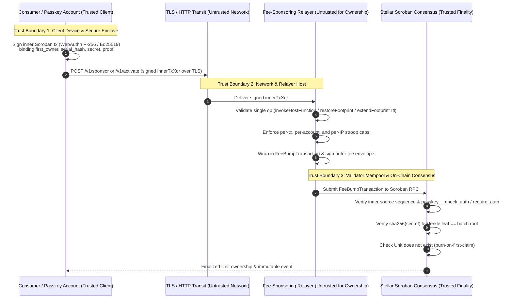

# Veritag Threat Model

This document expands on the security properties, trust boundaries, and mitigations implemented across the Veritag contract, backend relayer, indexer, and client applications.

## Trust Assumptions

1. **Stellar Soroban Consensus:** Assumed honest-majority and Byzantine-fault-tolerant for transaction finality, `require_auth` signature verification, and ledger timestamps.
2. **Backend & Database:** Treated as **untrusted for authenticity and ownership**. Even if PostgreSQL or the REST backend is compromised or offline, it cannot forge a Merkle batch commitment, transfer an owned unit without the owner's signature, or erase past on-chain events.
3. **Registry Admin:** Trusted only to verify that a registering brand controls its claimed DNS domain via `https://<domain>/.well-known/stellar.toml`. Recommended to be a Stellar multisig account in production.

---

## Attack Surfaces & Mitigations

### 1. QR Label Cloning & Mass Counterfeiting
- **Attack:** A counterfeiter photographs a genuine product's outer QR code in a retail store and prints 10,000 copies onto fake boxes.
- **Mitigations:**
  - **Batch Membership:** Invented serials fail Merkle verification (`VerifyStatus::Unknown`).
  - **Hidden Scratch-Off Secret:** `activate` requires the raw `secret` printed inside sealed packaging or beneath a tamper-evident scratch layer. Outer QR links never contain the secret.
  - **Burn on First Claim:** Once activated, the `Unit` record exists permanently. Subsequent activation attempts fail with `UnitAlreadyActivated`, while `report_duplicate_attempt` increments `duplicate_attempts` on-chain and triggers a public warning banner.
  - **Scan Telemetry:** Every public scan increments `scan_count`. Abnormal scan counts (>50 scans on an unclaimed item) surface a high-visibility cloning alert.

### 2. Activation Front-Running
- **Attack:** An attacker observes a pending `activate` transaction in the mempool, extracts `(serial_hash, proof, secret)`, and submits a competing transaction setting `first_owner` to the attacker's address.
- **Mitigation:** `VeritagRegistry::activate` enforces `first_owner.require_auth()`. A transaction signed by Alice cannot be re-targeted to Bob, and user activation requests travel directly to the fee-sponsoring relayer over TLS rather than gossiping unsigned secrets.

### 3. Pre-Shipment Merkle Secret Leakage
- **Attack:** Database compromise at the brand middleware exposes raw scratch-off secrets prior to retail sale.
- **Mitigations:**
  - Secrets are encrypted at rest with AES-256-GCM (`backend/src/services/merkle.ts`) immediately upon generation.
  - Print-line export (`GET /v1/brands/batches/:id/export?purge=true`) wipes `encrypted_secret` columns immediately after factory export (`410 Gone` on any subsequent export attempt), leaving only public `serial_hash`, `secret_hash`, and Merkle `proof` hashes in storage.

### 4. Fee Sponsor Account Draining
- **Attack:** Bots spam `/v1/activate` or `/v1/sponsor` to exhaust the sponsor account's XLM balance, or wrap arbitrary XLM `payment` operations inside sponsored transactions.
- **Mitigations:**
  - `StellarFeeSponsorService` inspects the inner transaction XDR and rejects any transaction with `!= 1` operation or any operation other than `invokeHostFunction`, `restoreFootprint`, or `extendFootprintTtl`.
  - Enforces a hard per-transaction stroop ceiling, per-account rolling stroop budget, per-IP rolling stroop budget, and `SlidingWindowRateLimiter` on public and authenticated write routes.

### 5. Brand Key Compromise & Rogue Service Centers
- **Attack:** A brand signing key or a third-party repair shop key is compromised.
- **Mitigations:**
  - Brands can rotate their operational signing key via `rotate_brand_admin(brand, new_admin)` while preserving their canonical `brand` address across all historical batches and QR URLs.
  - Service centers are scoped per-brand (`DataKey::ServiceCenter(brand, sc)`) and can be revoked instantaneously via `revoke_service_center`, which immediately blocks `file_claim` and `resolve_claim`.

### 6. Soroban State Archival
- **Attack / Operational Risk:** Persistent unit or batch records expire after multi-year warranties, causing verification or resale transfers to fail.
- **Mitigations:**
  - `activate` and all lifecycle mutations extend unit and batch TTLs to cover the remaining warranty plus a 90-day buffer (safely clamped to `env.storage().max_ttl()`).
  - Permissionless `bump_unit_ttl` and `bump_batch_ttl` entrypoints allow scheduled maintenance jobs to refresh long-lived warranties before archival.

---

## Relayer & Man-in-the-Middle (MitM) Threat Analysis

Veritag uses a fee-sponsoring relayer (`StellarFeeSponsorService` in `backend/src/services/relayer.ts`) to wrap user-signed Soroban transactions into Stellar `FeeBumpTransaction` envelopes so consumers can activate and transfer warranties without holding XLM. Because the relayer sits on the network path between the client and Stellar validators, it is modeled as an **untrusted intermediary** for ownership and authenticity.

### Architectural Sequence & Trust Boundaries

### Relayer Threat Vectors

#### 1. Relayer Key Compromise
- **Attack:** An attacker compromises the relayer host or extracts `SPONSOR_SECRET`, gaining the ability to sign `FeeBumpTransaction` envelopes as the sponsor account.
- **Impact:** The attacker can drain the sponsor account's XLM balance by sponsoring arbitrary transactions or submitting high-fee transactions, and can temporarily halt fee-sponsored onboarding. However, the attacker **cannot** forge `activate`, `transfer`, or `revoke` calls for any user or brand, because the sponsor signature only authorizes fee payment on the outer `FeeBumpTransaction` and never satisfies `first_owner.require_auth()` or `brand.require_auth()` on the inner Soroban invocation.
- **Mitigations:**
  - Keep only a bounded operational float in the sponsor account; top up from cold treasury on a schedule.
  - Isolate `SPONSOR_SECRET` in a secrets manager / KMS and rotate immediately if anomalous spend is detected.

#### 2. Fee Siphoning
- **Attack:** A malicious client or bot crafts inner transactions that wrap non-Veritag operations (e.g., XLM `payment` or `accountMerge`), nested `FeeBumpTransaction`s, or inflated `maxFee` values to siphon XLM from the relayer.
- **Mitigations:**
  - `StellarFeeSponsorService::sponsorFeeBump` rejects any `FeeBumpTransaction` (`NestedFeeBumpNotAllowed`), requires `innerTx.operations.length === 1` (`UnsupportedOperationCount`), and restricts operations exclusively to `invokeHostFunction`, `restoreFootprint`, and `extendFootprintTtl` (`UnsupportedSponsoredOperation`).
  - Enforces a hard `maxTxFeeStroops` ceiling (`FeeExceedsMaxAllowed`), per-account rolling window budget (`maxStroopsPerUserWindow`), and per-IP rolling window budget (`maxStroopsPerIpWindow`).

#### 3. Secret Interception (HTTP Transit MitM)
- **Attack:** A network-level adversary or compromised TLS termination proxy intercepts the scratch-off `secret` in HTTP transit during `/v1/activate` and attempts to claim the product for an attacker-controlled address.
- **Mitigations:**
  - **End-to-End Signed Inner Transactions:** When clients construct and sign the Soroban `activate` invocation locally (via passkey smart account or wallet), the `first_owner` parameter is cryptographically bound to the user's `require_auth()` signature. A MitM cannot substitute `first_owner` without invalidating the inner signature.
  - **One-Time Secret Hash Verification:** On-chain, `VeritagRegistry::activate` computes `secret_hash = merkle::sha256_bytes(&env, &secret)` and verifies `merkle::compute_leaf(&env, &serial_hash, &secret_hash)` against the committed Merkle root. Once redeemed, the `Unit` record is written permanently, rendering any intercepted `secret` useless for subsequent claims.
  - **Strict Transport Security:** All client-to-relayer traffic requires TLS 1.2+ with HSTS, minimizing plaintext exposure even for custodial/convenience flows.

#### 4. Transaction Front-Running & Double-Spend Reordering
- **Attack:** A rogue relayer operator or mempool observer extracts `(serial_hash, proof, secret)` from a pending `activate` request, drops or delays the user's transaction, and submits a competing transaction with `first_owner = attacker` (or reorders two conflicting transfers).
- **Mitigations:**
  - **Passkey Smart Account Authorization:** `VeritagRegistry::activate` enforces `first_owner.require_auth()`, and `passkey-account` verifies WebAuthn P-256 signatures inside `__check_auth` over the exact Soroban authorization payload (including contract address, function name, and arguments). An attacker cannot reuse a user's authorization with a different `first_owner`.
  - **Idempotency & Replay Guarantees:**
    - Each Stellar inner transaction carries a monotonically increasing source-account sequence number and Soroban `signatureExpirationLedger`, preventing replay or out-of-order execution of signed transactions.
    - `Unit` creation is atomic and single-use: if two competing `activate` transactions race, the first succeeds and the second deterministically fails with `UnitAlreadyActivated` (`duplicate_attempts` telemetry can be recorded separately).
  - **Direct Submission Fallback:** Because `FeeBumpTransaction` sponsorship is optional, a censored user can always self-submit their signed inner transaction directly to any public Soroban RPC node.

#### 5. Relayer Denial-of-Service (DoS)
- **Attack:** Volumetric floods exhaust relayer CPU, Stellar RPC rate limits, or per-IP/per-account sponsorship quotas, blocking legitimate consumers from activating warranties.
- **Mitigations:**
  - `SlidingWindowRateLimiter` on public and authenticated write routes sheds abusive traffic before XDR parsing or RPC simulation.
  - Per-IP and per-account stroop budgets isolate quota exhaustion to the offending caller rather than starving unrelated users.
  - Stateless inner-transaction construction allows consumers to bypass a degraded relayer and submit directly to Soroban RPC.

### Protocol Mitigations Summary

| Mechanism | Layer | Security Guarantee |
| --- | --- | --- |
| **On-chain one-time secret hashes (`sha256(secret)`)** | `contracts/registry` (`merkle::sha256_bytes`, `compute_leaf`) | Raw secret is never stored on-chain; knowledge of `secret` is proven once at activation and immediately invalidated by `Unit` creation. |
| **Passkey smart account authorization (`require_auth` / `__check_auth`)** | `contracts/passkey-account`, `contracts/registry` | WebAuthn P-256 signatures bind the caller's address and exact invocation arguments, preventing parameter tampering or front-running hijacks. |
| **Idempotency & replay protection** | Stellar Consensus & `VeritagRegistry` | Monotonic account sequence numbers, Soroban auth nonces/expiration ledgers, and burn-on-first-claim `Unit` storage guarantee at-most-once activation. |
| **Strict outer envelope inspection** | `backend/src/services/relayer.ts` (`StellarFeeSponsorService`) | Single-operation allowlist (`invokeHostFunction`, `restoreFootprint`, `extendFootprintTtl`) and rolling stroop caps bound sponsor exposure. |

### Relayer Threat Matrix

| Threat Vector | Likelihood | Impact | Mitigation | Residual Risk |
| --- | --- | --- | --- | --- |
| **Relayer Key Compromise** | Low | Medium (XLM float loss; temporary sponsorship outage; no ownership forgery) | Bounded hot-wallet float, KMS secret storage, key rotation, `require_auth` isolation | **Low** |
| **Fee Siphoning** | High | Medium (Sponsor XLM depletion) | Single-op allowlist, `NestedFeeBumpNotAllowed`, per-tx/per-account/per-IP stroop caps | **Low** |
| **Secret Interception (HTTP MitM)** | Low | High (Unauthorized claim if unsigned) | TLS 1.2+/HSTS, client-signed inner tx binding `first_owner`, one-time `sha256(secret)` burn | **Low** |
| **Transaction Front-Running & Reordering** | Medium | High (Hijacked unit activation or transfer) | `first_owner.require_auth()` / WebAuthn `__check_auth`, Soroban auth nonces & sequence numbers, direct RPC fallback | **Low** |
| **Relayer Denial-of-Service (DoS)** | Medium | Medium (Onboarding delay for gasless users) | `SlidingWindowRateLimiter`, per-IP/account quotas, permissionless direct Soroban RPC submission | **Medium** |
